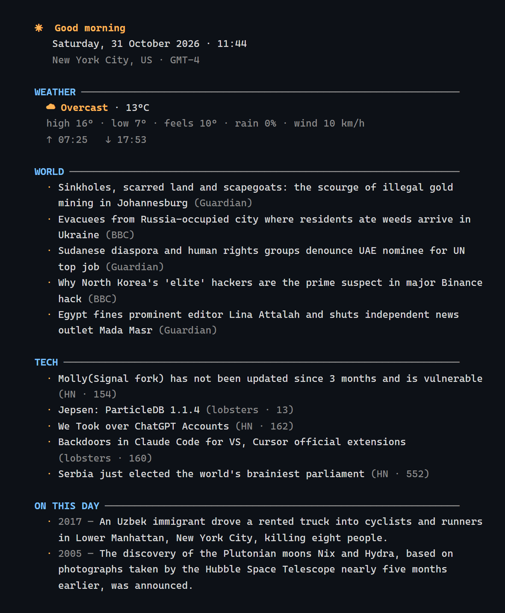

# morning

**A one-screen daily briefing for your terminal.** Weather, world news, and tech headlines — before the coffee cools.



[](https://github.com/epicshawty/morning/actions/workflows/ci.yml)
[](https://github.com/epicshawty/morning/releases/latest)
[](LICENSE)
[](go.mod)
[](#install)
[](#data-sources)
[](https://github.com/epicshawty/morning/pulls)

## Install

```sh
go install github.com/epicshawty/morning@latest
```

Or take a single static binary from [Releases](https://github.com/epicshawty/morning/releases/latest) — Linux, macOS, Windows, BSD, Solaris, AIX on amd64, arm64, arm, 386, riscv64, ppc64le, s390x and loong64. No runtime, no API keys, no signup.

## Usage

```sh
morning
```

That is the whole thing. Location is detected from your IP unless you say otherwise.

| Flag | Default | Meaning |
|---|---|---|
| `-city <name>` | auto | City to report on, e.g. `-city Osaka` |
| `-units c\|f` | `c` | Temperature units |
| `-sections <list>` | all | Any of `weather,world,tech,fact` |
| `-limit <n>` | `5` | Headlines per section (1–20) |
| `-json` | off | Machine-readable output |
| `-plain` | off | Force plain text |
| `-color <mode>` | `auto` | `auto`, `always`, `never` |
| `-width <n>` | terminal | Wrap width |
| `-no-cache` | off | Bypass the 10-minute cache |
| `-config <path>` | see below | Config file |
| `-version` | — | Print version |

### In a pipe

Styling is dropped automatically when stdout is not a terminal, so this stays clean:

```sh
morning | grep -A3 TECH
morning -json | jq -r '.weather.temp_c'
morning -sections weather,tech >> ~/log/today.txt
```

Respects [`NO_COLOR`](https://no-color.org).

## Config

Optional. Written to `~/.config/morning/config.json` on Linux and macOS, `%AppData%\morning\config.json` on Windows.

```json
{
  "city": "Osaka",
  "units": "c",
  "limit": 5,
  "sections": ["weather", "world", "tech", "fact"]
}
```

Flags override the file; the file overrides defaults.

## Data sources

Every source is keyless and public.

| Section | Source |
|---|---|
| Weather | [Open-Meteo](https://open-meteo.com) (forecast, geocoding, sunrise/sunset) |
| World | BBC, NPR, Guardian, Al Jazeera RSS |
| Tech | [Hacker News](https://news.ycombinator.com) API, [Lobsters](https://lobste.rs) |
| On this day | Wikimedia REST feed |
| Location | ipinfo.io, then ip-api.com |

Responses are cached on disk for 10 minutes. A failing section degrades to a one-line notice; it never kills the briefing.

## Build

```sh
git clone https://github.com/epicshawty/morning
cd morning
go build -trimpath -ldflags "-s -w -X main.version=$(git describe --tags --always)" -o morning .
```

Cross-compile without any extra toolchain:

```sh
GOOS=linux GOARCH=riscv64 go build .
GOOS=darwin GOARCH=arm64 go build .
```

Tests: `go test ./...`

## License

[AGPL-3.0-or-later](LICENSE). If you run a modified `morning` as a network service, you publish the source.
